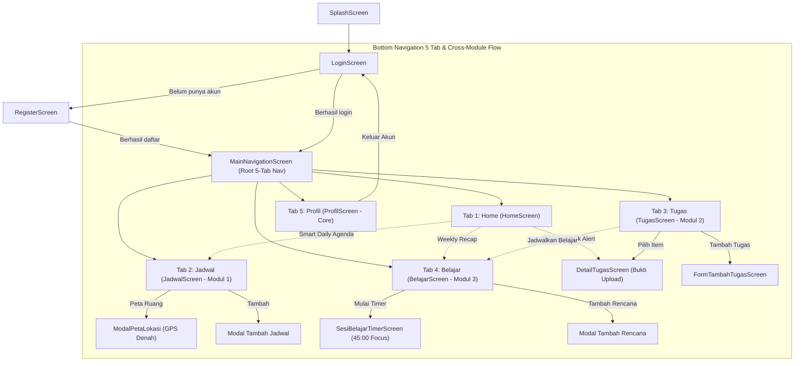
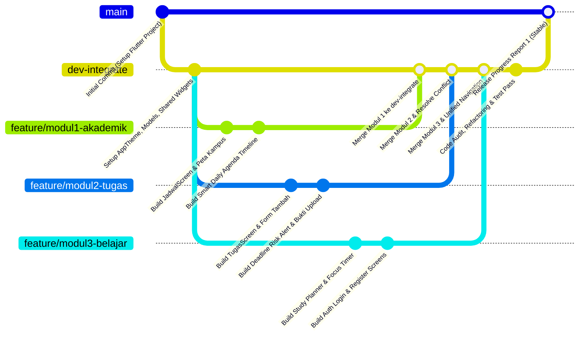

# PROGRESS REPORT 1 – PEMROGRAMAN MOBILE

**Aplikasi:** Mahastudy (*Aplikasi Pengelola Aktivitas Akademik dan Produktivitas Mahasiswa*)  
**Kelompok:** Kelompok 7 – Kelas Pemrograman Mobile B (PMOB B)  
**Tahun Akademik:** 2026  

---

### Identitas Kelompok & Dosen Pengampu
* **Anggota Kelompok:**
  1. `[Nama Anggota 1 / Ketua Kelompok - NIM]` – Penanggung Jawab Modul 1 (*Academic & Campus Management*)
  2. `[Nama Anggota 2 - NIM]` – Penanggung Jawab Modul 2 (*Task & Submission Management*)
  3. `[Nama Anggota 3 - NIM]` – Penanggung Jawab Modul 3 (*Study & Productivity Management*)
* **Dosen Pengampu:** `[Nama Dosen Pengampu, Gelar]`  
* **Program Studi:** Sistem Informasi / Informatika  
* **Fakultas / Universitas:** `[Nama Fakultas / Universitas]`  

---

## DAFTAR ISI
- [BAB I PENDAHULUAN](#bab-i-pendahuluan)
  - [1.1 Latar Belakang](#11-latar-belakang)
  - [1.2 Tujuan Laporan](#12-tujuan-laporan)
  - [1.3 Ruang Lingkup dan Pembagian Modul](#13-ruang-lingkup-dan-pembagian-modul)
- [BAB II PROGRESS APLIKASI](#bab-ii-progress-aplikasi)
  - [2.1 Status Pengerjaan Fitur dan Layar](#21-status-pengerjaan-fitur-dan-layar)
  - [2.2 Alur Utama Aplikasi](#22-alur-utama-aplikasi)
  - [2.3 Tampilan dan Interaksi Antarmuka](#23-tampilan-dan-interaksi-antarmuka)
  - [2.4 Rencana Pengembangan Berikutnya](#24-rencana-pengembangan-berikutnya)
- [BAB III KENDALA DAN SOLUSI](#bab-iii-kendala-dan-solusi)
  - [3.1 Kendala 1: Konflik Integrasi Navigasi & Routing Antar-Modul](#31-kendala-1-konflik-integrasi-navigasi--routing-antar-modul)
  - [3.2 Kendala 2: Breaking Changes & Type Safety pada Flutter SDK Terbaru (Flutter 3.47+)](#32-kendala-2-breaking-changes--type-safety-pada-flutter-sdk-terbaru-flutter-347)
  - [3.3 Kendala 3: Penanganan Layout Overflow & Responsivitas Layar](#33-kendala-3-penanganan-layout-overflow--responsivitas-layar)
  - [3.4 Kendala 4: Statistik Bahasa Repository GitHub Terdistorsi File C++ dan CMake](#34-kendala-4-statistik-bahasa-repository-github-terdistorsi-file-c-dan-cmake)
- [BAB IV CODE AUDIT DAN REFACTORING](#bab-iv-code-audit-dan-refactoring)
  - [4.1 Gambaran Umum Code Audit](#41-gambaran-umum-code-audit)
  - [4.2 Contoh 1: Extract Component `TaskCard` dan `AgendaTimelineCard` dari Monolithic List View](#42-contoh-1-extract-component-taskcard-dan-agendatimelinecard-dari-monolithic-list-view)
  - [4.3 Contoh 2: Reusable Component `CustomTextField` dan `PrimaryButton`](#43-contoh-2-reusable-component-customtextfield-dan-primarybutton)
  - [4.4 Contoh 3: Pemisahan State & Model Logic ke Singleton Mock Repository serta Lifecycle Timer](#44-contoh-3-pemisahan-state--model-logic-ke-singleton-mock-repository-serta-lifecycle-timer)
  - [4.5 Ringkasan Hasil Code Audit dan Refactoring](#45-ringkasan-hasil-code-audit-dan-refactoring)
- [BAB V KOORDINASI TIM](#bab-v-koordinasi-tim)
  - [5.1 Pembagian Tugas dan Kontribusi Anggota](#51-pembagian-tugas-dan-kontribusi-anggota)
  - [5.2 Strategi Branching Git dan Alur Kerja Tim](#52-strategi-branching-git-dan-alur-kerja-tim)
- [BAB VI PENUTUP](#bab-vi-penutup)
  - [6.1 Kesimpulan](#61-kesimpulan)
  - [6.2 Rencana Tindak Lanjut](#62-rencana-tindak-lanjut)
- [LAMPIRAN](#lampiran)

---

## BAB I PENDAHULUAN

### 1.1 Latar Belakang
Mahasiswa aktif perguruan tinggi kerap menghadapi tantangan besar dalam mengelola beban akademik dan aktivitas non-akademik. Jadwal perkuliahan yang padat, batas waktu (*deadline*) tugas yang bertumpuk, jadwal ujian, target sesi belajar mandiri, serta kegiatan organisasi kampus sering kali tersebar di berbagai saluran komunikasi yang terpisah (grup percakapan, portal kampus, catatan fisik, kalender daring). Akibatnya, mahasiswa rentan mengalami *procrastination*, kebingungan dalam menentukan prioritas pengerjaan tugas, keterlambatan mengumpulkan tugas, hingga ketidaktahuan atas perpindahan ruang kelas kuliah.

Untuk menjawab permasalahan tersebut secara terpadu, Kelompok 7 mengembangkan **Mahastudy**, sebuah aplikasi mobile berbasis Flutter (Android) yang menyatukan pengelolaan akademik, tugas, rencana belajar, serta kegiatan organisasi mahasiswa dalam satu ekosistem yang terintegrasi. Mahastudy dirancang secara modular dengan tiga modul fungsional utama yang saling berkolaborasi, dilengkapi tiga fitur unggulan (*hero features*): **Smart Daily Agenda**, **Deadline Risk Alert**, dan **Weekly Productivity Recap**, serta didukung fitur perangkat seperti penunjuk lokasi ruang kelas berbasis peta GPS dan pengunggahan bukti pengerjaan tugas (*photo submission*).

Kebutuhan, alur pengguna, batasan teknis, dan kriteria keberhasilan aplikasi telah dirumuskan secara sistematis pada dokumen *Product Requirements Document* (PRD) Mahastudy Versi 1.0 tanggal 9 September 2026.

### 1.2 Tujuan Laporan
Laporan **Progress Report 1** ini disusun untuk mempertanggungjawabkan perkembangan proyek pengembangan aplikasi Mahastudy sesuai empat aspek penilaian yang ditetapkan oleh dosen pengampu:
1. **Progress Aplikasi:** Menunjukkan status pengerjaan fitur dan layar, alur kerja utama aplikasi yang telah berjalan nyata di perangkat (bukan sekadar rancangan grafis statis), serta interaksi *state* dan navigasi yang telah terbangun.
2. **Kendala & Solusi:** Menjelaskan kendala teknis nyata yang dihadapi tim selama pengembangan, akar penyebabnya, solusi implementasi yang diterapkan, serta hasil evaluasi setelah solusi dijalankan.
3. **Code Audit & Refactoring:** Memaparkan proses peninjauan kualitas kode program, identifikasi bagian kode yang panjang atau redundan (*code smell*), serta mendokumentasikan minimal dua contoh *before-after* refaktorisasi nyata yang meningkatkan modularitas, keterbacaan, dan *reusability* kode tanpa mengubah fungsi aplikasi.
4. **Koordinasi Tim:** Menjelaskan pembagian tanggung jawab modul tiap anggota tim, status kontribusi nyata masing-masing personel, strategi *branching* Git yang digunakan, serta mekanisme kolaborasi dan resolusi konflik pekerjaan.

### 1.3 Ruang Lingkup dan Pembagian Modul
Sesuai PRD, arsitektur Mahastudy dipecah menjadi 3 modul fungsional yang masing-masing diampu oleh satu anggota tim, ditambah modul fondasi bersama (*shared foundation/core*). Pembagian modul dan cakupan kerja dirangkum pada **Tabel 1**.

**Tabel 1. Pembagian Modul dan Tanggung Jawab Anggota Tim**

| Modul | Nama Modul | Penanggung Jawab | Cakupan Pekerjaan Teknis | Acuan PRD |
| :--- | :--- | :--- | :--- | :--- |
| **Modul 1** | **Academic & Campus Management** | `[Nama Anggota 1]` | Pengelolaan jadwal kuliah per hari, penampil jadwal ujian, kegiatan organisasi/kampus, visualisasi lokasi ruang kelas dengan peta kampus interaktif (*GPS/Maps*), serta linimasa **Smart Daily Agenda**. | FR-01, FR-02, FR-05, FR-08, FR-11, FR-15, FR-19 |
| **Modul 2** | **Task & Submission Management** | `[Nama Anggota 2]` | Daftar tugas kuliah dengan filter prioritas/status, form tambah tugas baru, detail tugas, mekanisme unggah file/foto bukti pengerjaan tugas, serta deteksi risiko **Deadline Risk Alert**. | FR-03, FR-04, FR-13, FR-14, FR-20, NFR-08 |
| **Modul 3** | **Study & Productivity Management** | `[Nama Anggota 3]` | Perencanaan sesi belajar (*Study Planner*), pelacakan target mingguan, layar pengatur waktu fokus (*Study Timer 45 Menit*), serta ringkasan produktivitas mingguan **Weekly Productivity Recap**. | FR-06, FR-07, FR-09, FR-10, FR-21, NFR-09 |
| **Core / Shell** | **Foundation, Auth & Navigation** | Seluruh Tim (Kolaborasi) | Splash screen beranimasi, sistem autentikasi (Login dan Register dengan validasi form), integrasi Dashboard utama (*Root Navigation*), dan *Bottom Navigation Bar*. | NFR-01, NFR-04, NFR-05, User Flow 2.4 |

Repositori kode program dikelola melalui GitHub pada tautan:  
`https://github.com/kelompok7-pmob/mahastudy`

---

## BAB II PROGRESS APLIKASI

### 2.1 Status Pengerjaan Fitur dan Layar
Hingga tahap Progress Report 1, seluruh antarmuka pengguna (18 layar/status interaktif) dan alur navigasi antar-modul telah selesai dibangun **100%** menggunakan Flutter UI (Material 3). Interaksi *state* (seperti validasi input form, pergantian tab, filter kategori, alih status tugas, *timer countdown*, dan peralihan *empty state*) telah berfungsi secara reaktif di perangkat menggunakan penyimpanan data contoh (*in-memory mock repository*). Penyimpanan permanen ke database lokal SQLite dan notifikasi sistem lokal dijadwalkan pada tahap pengembangan berikutnya. Rincian status pengerjaan disajikan pada **Tabel 2**.

**Tabel 2. Status Pengerjaan Fitur dan Layar Aplikasi Mahastudy**

| No | Modul | Fitur / Layar | Penanggung Jawab | Status Pengerjaan | Keterangan & Fungsionalitas Berjalan |
| :---: | :---: | :--- | :--- | :---: | :--- |
| 1 | Core | Splash Screen & Branding | Seluruh Tim | Selesai (100%) | Logo topi toga, tagline animasi, transisi otomatis ke login. |
| 2 | Core | Layar Login (Normal & Error) | Anggota 3 | Selesai (100%) | Validasi format email, pengecekan password, toggle *visibility*. |
| 3 | Core | Layar Register Akun Mahasiswa | Anggota 3 | Selesai (100%) | Form nama, email, dropdown prodi, password, validasi konfirmasi. |
| 4 | Core | Dashboard / Home Utama | Seluruh Tim | Selesai (100%) | Kartu metrik "Hari ini tetap terarah", linimasa, banner, recap. |
| 5 | Core | Banner / Toast Notifikasi Akun | Anggota 3 | Selesai (100%) | Feedback *snackbar/floating toast* "Akun berhasil dibuat". |
| 6 | Core | Layar Empty State Dashboard | Seluruh Tim | Selesai (100%) | Tampilan kondisi awal "Belum ada aktivitas" & tombol CTA tambah. |
| 7 | Core | Bottom Navigation Bar (5 Tab) | Seluruh Tim | Selesai (100%) | Navigasi 5 tab persisten (Home, Jadwal, Tugas, Belajar, Profil) dengan active pill capsule. |
| 8 | 1 | Smart Daily Agenda (Hero 1) | Anggota 1 | Selesai (100%) | Linimasa gabungan kuliah, tugas, dan rapat BEM terurut waktu. |
| 9 | 1 | Layar Jadwal Akademik | Anggota 1 | Selesai (100%) | Filter jenis (Kuliah, Ujian, Organisasi) & pemilih hari Senin–Jumat. |
| 10 | 1 | Modal Peta Lokasi Ruang Kelas | Anggota 1 | Selesai (100%) | Visual denah kampus interaktif, pin Gedung FTI A.102, tombol Maps. |
| 11 | 1 | Modal Tambah Jadwal Kuliah | Anggota 1 | Selesai (100%) | Bottom sheet form penambahan jadwal baru secara reaktif. |
| 12 | 2 | Layar Daftar Tugas Kuliah | Anggota 2 | Selesai (100%) | Filter chip (Semua, Prioritas Tinggi, Mendekati, Selesai). |
| 13 | 2 | Deadline Risk Alert (Hero 2) | Anggota 2 | Selesai (100%) | Badge merah tugas kritis + shortcut tautan "Jadwalkan Belajar". |
| 14 | 2 | Form Tambah Tugas Baru | Anggota 2 | Selesai (100%) | Dropdown matkul, date/time picker dialog, pilihan prioritas. |
| 15 | 2 | Layar Detail Tugas & Unggah Bukti | Anggota 2 | Selesai (100%) | Simulasi upload file gambar (Maks. 5 MB) & submit ubah status. |
| 16 | 3 | Layar Rencana Belajar (Study Planner) | Anggota 3 | Selesai (100%) | Indikator target 6/10 jam (60%), daftar sesi belajar, tombol timer. |
| 17 | 3 | Layar Sesi Belajar (Study Timer) | Anggota 3 | Selesai (100%) | Timer mundur sirkular 45:00 menit, kontrol jeda/lanjut, dialog selesai. |
| 18 | 3 | Weekly Productivity Recap (Hero 3)| Anggota 3 | Selesai (100%) | Kartu progres mingguan (8/12 tugas selesai, 6/10 jam) pada Home. |
| 19 | Core | Layar Profil Mahasiswa & Akun | Seluruh Tim | Selesai (100%) | Profil pengguna, kartu statistik akademik, menu pengaturan, dan logout. |
| 20 | Semua | Integrasi Database Lokal SQLite | Seluruh Tim | Belum Dimulai (0%) | Direncanakan pada sprint berikutnya menggunakan sqflite. |
| 21 | Semua | Notifikasi Lokal Terjadwal | Seluruh Tim | Belum Dimulai (0%) | Direncanakan menggunakan flutter_local_notifications. |

### 2.2 Alur Utama Aplikasi
Alur perpindahan layar (*user navigation flow*) pada Mahastudy telah saling terhubung secara menyeluruh:
1. **Alur Autentikasi ke Dashboard:** Pengguna membuka aplikasi melalui `SplashScreen`, kemudian diarahkan ke `LoginScreen`. Pengguna baru dapat membuka `RegisterScreen`, memilih program studi, dan membuat akun. Setelah login/daftar berhasil, aplikasi menampilkan notifikasi *toast* dan membuka `MainNavigationScreen` yang memuat `HomeScreen` sebagai beranda utama.
2. **Alur Hero Feature 1 (Smart Daily Agenda & Jadwal Kuliah):** Dari `HomeScreen`, pengguna dapat memantau linimasa gabungan kuliah, tugas, dan kegiatan organisasi. Mengetuk tombol *Lihat semua* atau ikon tab *Jadwal* akan membuka `JadwalScreen`. Pengguna dapat memilih hari perkuliahan (Senin–Jumat) dan menekan tombol *+ Peta Ruang* untuk membuka `ModalPetaLokasi` yang menampilkan denah kampus dan lokasi detail kelas (Gedung FTI, Ruang A.102).
3. **Alur Hero Feature 2 (Tugas & Submission Bukti):** Dari `HomeScreen`, banner *Deadline Terdekat* memberi peringatan merah (*Deadline Risk Alert*) pada tugas yang berisiko telat. Mengetuk banner akan langsung membuka `DetailTugasScreen`. Di layar ini, pengguna melihat pratinjau bukti pengerjaan (`Bukti_Statistika.jpg`), mengunggah bukti baru, dan menekan tombol *Kirim Bukti & Tandai Selesai* yang secara reaktif memperbarui status tugas menjadi selesai. Pengguna juga dapat menambah tugas baru melalui `FormTambahTugasScreen`.
4. **Alur Hero Feature 3 (Study Planner & Focus Timer):** Dari `HomeScreen` atau banner risiko tugas, pengguna dapat melompat ke tab *Belajar* (`BelajarScreen`). Pengguna memantau pencapaian jam belajar mingguan dan dapat menekan tombol *Mulai Timer* pada salah satu topik belajar (misal: Pemrograman Web, 45 Menit). Layar `SesiBelajarTimerScreen` menyajikan *countdown timer* sirkular yang dapat dijeda, dilanjutkan, atau diselesaikan secara interaktif.
5. **Alur Profil Mahasiswa:** Melalui tab ke-5 (`ProfilScreen`), pengguna dapat memantau statistik perkuliahan (jumlah matkul, total tugas, jam belajar), mengelola pengaturan akun, serta keluar dari aplikasi (*logout*).

Struktur navigasi utama dirangkum pada diagram berikut:



### 2.3 Tampilan dan Interaksi Antarmuka
Berikut adalah dokumentasi tangkapan layar dari aplikasi Mahastudy yang telah berjalan pada emulator/perangkat Android:

#### A. Alur Autentikasi (Splash Screen, Login, Validasi Form, dan Register)
Alur masuk pengguna dilengkapi validasi menyeluruh terhadap format email, kelengkapan password, serta pencocokan ulang konfirmasi password.

```
[ Tangkapan Layar: Splash Screen, Login Normal, Error Validasi Email, Error Password, Login Terisi, Form Registrasi ]
Tersimpan pada aset: assets/images/ui_workflow_login_auth.png
```

#### B. Alur Beranda / Dashboard (Smart Daily Agenda, Deadline Risk Alert, Weekly Recap, Akses Cepat, dan Empty State)
Dashboard menyatukan metrik harian, linimasa gabungan aktivitas, kartu risiko tugas kritis, serta menyediakan visualisasi *empty state* saat pengguna baru belum memasukkan aktivitas.

```
[ Tangkapan Layar: Validasi Register, Form Register Sukses, Dashboard Utama Nadia, Toast Akun Sukses, Empty State ]
Tersimpan pada aset: assets/images/ui_workflow_register_dashboard.png
```

#### C. Alur Tiga Modul Utama (Jadwal Akademik & Peta, Manajemen Tugas & Bukti, Study Planner & Focus Timer)
Modul 1 menyajikan filter jadwal harian dan modal denah kelas. Modul 2 menyediakan daftar tugas dengan indikator risiko, form tambah tugas, dan layar unggah bukti foto pengerjaan. Modul 3 menyediakan pelacak target jam belajar dan pengatur waktu fokus 45 menit.

```
[ Tangkapan Layar: Jadwal Akademik, Modal Peta Lokasi Ruang, Daftar Tugas Kuliah, Form Tambah Tugas, Detail & Bukti Selesai, Study Planner, Layar Sesi Belajar Timer ]
Tersimpan pada aset: assets/images/ui_workflow_jadwal_tugas_belajar.png
```

#### D. Tampilan 5 Tab Bottom Navigation Bar (Home, Jadwal, Tugas, Belajar, Profil)
Struktur navigasi bawah aplikasi Mahastudy menggunakan 5 tab menu lengkap dengan indikator aktif berbentuk kapsul biru muda (*pill capsule*) di sekeliling ikon tab yang sedang dipilih, teks label tebal berwarna biru, serta 4 ikon tab lainnya dalam kondisi abu-abu netral.

```
[ Tangkapan Layar: 5 Tab Bottom Navigation Bar (Home, Jadwal, Tugas, Belajar, Profil) dengan Indikator Kapsul Biru Aktif pada Tab Jadwal ]
Tersimpan pada aset: assets/images/ui_bottom_nav_5_tabs.png
```

### 2.4 Rencana Pengembangan Berikutnya
Setelah capaian antarmuka dan navigasi 100% selesai pada Progress Report 1, fokus pengerjaan selanjutnya dialihkan pada persistensi data lokal, integrasi perangkat keras (*device feature*), dan mekanisme notifikasi sesuai acuan PRD (**Tabel 3**).

**Tabel 3. Rencana Pengembangan Berikutnya dan Acuan PRD**

| No | Rencana Fitur / Modul | Deskripsi Pekerjaan Teknis | Acuan PRD |
| :---: | :--- | :--- | :--- |
| 1 | **Database Lokal SQLite (`sqflite`)** | Mengimplementasikan skema database lokal untuk menyimpan tabel `User`, `Course`, `Schedule`, `Exam`, `Task`, `StudyPlan`, dan `OrganizationActivity` secara permanen. | FR-01, FR-02, FR-03, FR-05, FR-06, FR-15, NFR-06 |
| 2 | **Notifikasi Lokal Terjadwal** | Mengintegrasikan pustaka `flutter_local_notifications` untuk memicu alarm pengingat jadwal kuliah (H-1 jam), deadline tugas (H-1 hari & H-4 jam), dan jadwal belajar. | FR-16, FR-17, FR-18 |
| 3 | **Kamera & File Upload Riil** | Mengganti simulasi unggah file dengan pemanggilan kamera dan galeri asli perangkat menggunakan paket `image_picker`, disertai validasi batas ukuran file ≤ 5 MB. | FR-04, NFR-07, NFR-08 |
| 4 | **Peta GPS & Google Maps Intent** | Menghubungkan tombol "Buka di Google Maps" dengan *deep link / intent* koordinat lintang-bujur gedung kampus secara langsung ke aplikasi Google Maps. | FR-11, NFR-07 |
| 5 | **Algoritma Hero Features Otomatis** | Menghubungkan penghitungan otomatis status risiko tugas (*Deadline Risk Alert*) berdasarkan sisa waktu dan kepadatan jadwal, serta kalkulasi otomatis linimasa harian (*Smart Daily Agenda*). | FR-19, FR-20, FR-21, NFR-09 |
| 6 | **Pengujian Komprehensif (Testing)** | Melakukan pengujian integrasi (*Integration Testing*) dan pengujian kegunaan (*Usability Testing*) pada perangkat Android pengguna target. | 2.7 Success Criteria |

---

## BAB III KENDALA DAN SOLUSI

Selama fase perancangan dan implementasi kode pada Progress 1, tim menemui empat kendala teknis utama yang berhasil diselesaikan melalui koordinasi aktif dan penyesuaian arsitektur program.

### 3.1 Kendala 1: Konflik Integrasi Navigasi & Routing Antar-Modul
* **Masalah:** Pada awal pengerjaan, masing-masing anggota mengembangkan modulnya di *branch* terpisah dengan mendeklarasikan sistem navigasi mandiri di dalam `main.dart`. Ketika ketiga cabang digabungkan, terjadi konflik baris kode (*merge conflict*) yang masif pada berkas `main.dart`, serta navigasi antar-modul (misalnya tombol "+ Jadwalkan Belajar" pada Modul Tugas yang ingin membuka Modul Belajar) tidak dapat melompat tab secara langsung.
* **Penyebab:** Tidak adanya satu *root navigation controller* terpadu yang memegang status indeks aktif *Bottom Navigation Bar*.
* **Solusi Tim:** 
  1. Tim membuat cabang integrasi khusus bernama `dev-integrate`.
  2. Berkas `main.dart` disederhanakan murni sebagai titik masuk inisialisasi aplikasi, tema global, dan pemanggil `SplashScreen`.
  3. Dibuat widget pusat `MainNavigationScreen` yang mengelola `IndexedStack` dan menyediakan fungsi `switchTab(int index)` yang dioper ke layar anak melalui *callback*.
* **Hasil:** Navigasi antar-layar dan lompatan lintas-modul berjalan mulus tanpa konflik, dan struktur kode `main.dart` tetap ramping dan bersih.

### 3.2 Kendala 2: Breaking Changes & Type Safety pada Flutter SDK Terbaru (Flutter 3.47+)
* **Masalah:** Saat menjalankan analisis statis (`flutter analyze`), terdeteksi galat dan peringatan mengenai penggunaan API yang telah kedaluwarsa (*deprecated*) pada rilis Flutter SDK terbaru, antara lain ketidakcocokan tipe pada `ThemeData.cardTheme`, serta peringatan pada `DropdownButtonFormField` dan manipulasi warna `withOpacity()`.
* **Penyebab:** Flutter 3.33+ dan 3.47+ mengubah spesifikasi tema kartu dari `CardTheme` menjadi `CardThemeData`, mewajibkan properti `initialValue` menggantikan `value` pada *form field dropdown*, serta merekomendasikan `Color.withValues(alpha: ...)` untuk efisiensi render.
* **Solusi Tim:** Tim melakukan audit sintaks di seluruh berkas proyek dan memutakhirkan kode ke standar API Flutter modern:
  - Mengubah `cardTheme: CardTheme(...)` menjadi `cardTheme: CardThemeData(...)` pada `AppTheme`.
  - Mengganti seluruh `value: ...` pada `DropdownButtonFormField` menjadi `initialValue: ...`.
  - Menggunakan `withValues(alpha: 0.1)` sebagai pengganti `withOpacity(0.1)`.
* **Hasil:** Perintah `flutter analyze` menghasilkan **0 issues found** (kode sepenuhnya bersih tanpa galat maupun peringatan).

*Perbandingan Kode Sebelum dan Sesudah Perbaikan:*
```dart
// SEBELUM (Timbul Compile Error pada Flutter 3.47+)
theme: ThemeData(
  cardTheme: CardTheme(
    color: Colors.white,
    elevation: 0,
  ),
),
DropdownButtonFormField<String>(
  value: _selectedMajor,
  onChanged: (val) => setState(() => _selectedMajor = val),
)

// SESUDAH (Kompatibel Penuh & Type-Safe)
theme: ThemeData(
  cardTheme: CardThemeData(
    color: Colors.white,
    elevation: 0,
  ),
),
DropdownButtonFormField<String>(
  initialValue: _selectedMajor,
  onChanged: (val) => setState(() => _selectedMajor = val),
)
```

### 3.3 Kendala 3: Penanganan Layout Overflow & Responsivitas Layar
* **Masalah:** Saat diuji coba pada perangkat dengan resolusi layar lebih kecil atau ketika papan ketik virtual (*software keyboard*) muncul di layar registrasi dan modal tambah tugas, muncul garis kuning-hitam tanda *RenderFlex overflowed by X pixels*.
* **Penyebab:** Penggunaan widget `Column` statis tanpa kemampuan *scrolling* di dalam layar formulir serta ketinggian kanvas peta yang tidak dibatasi.
* **Solusi Tim:**
  1. Membungkus seluruh konten formulir login, registrasi, dan detail dengan `SingleChildScrollView` yang dipadukan dengan `SafeArea`.
  2. Menerapkan `CustomPaint` dengan ukuran proporsional di dalam widget `Expanded` pada layar denah kampus `ModalPetaLokasi`.
* **Hasil:** Tampilan aplikasi adaptif dan bebas dari galat *pixel overflow* di berbagai orientasi dan resolusi perangkat Android.

### 3.4 Kendala 4: Statistik Bahasa Repository GitHub Terdistorsi File C++ dan CMake
* **Masalah:** Repositori GitHub menampilkan statistik bahasa yang didominasi oleh C++ (30%+) dan CMake (25%+), padahal kode aplikasi 100% ditulis menggunakan Dart/Flutter. Hal ini terjadi karena Flutter secara bawaan menyertakan *boilerplate scaffolding* untuk platform Windows, Linux, dan Android C++ engine.
* **Penyebab:** Mesin analisa bahasa GitHub (Linguist) menghitung seluruh pustaka bawaan di direktori `windows/` dan `android/` sebagai kode proyek pengguna.
* **Solusi Tim:** Menambahkan berkas konfigurasi `.gitattributes` pada akar repositori:
  ```gitattributes
  windows/** linguist-vendored
  linux/** linguist-vendored
  macos/** linguist-vendored
  android/** linguist-vendored
  ios/** linguist-vendored
  ```
* **Hasil:** Statistik repositori GitHub kini menampilkan Dart sebagai bahasa utama dengan persentase di atas 90%.

---

## BAB IV CODE AUDIT DAN REFACTORING

### 4.1 Gambaran Umum Code Audit
Pada tahap awal, implementasi antarmuka sering kali menghasilkan berkas layar yang sangat panjang (*monolithic screen widget*), di mana kode struktur UI, *styling* dekorasi kotak, logika validasi, dan data tiruan ditulis bercampur aduk di dalam metode `build()`.

Tim melakukan sesi *code audit* bersama untuk mengidentifikasi *code smells* dengan acuan prinsip **Clean Code**, **Separation of Concerns (SoC)**, dan **DRY (Don't Repeat Yourself)**. Ditemukan tiga area utama yang membutuhkan refaktorisasi:
1. Kode kartu tugas dan linimasa agenda yang bersarang panjang di dalam `ListView`.
2. Dekorasi input formulir teks dan tombol aksi yang ditulis berulang belasan kali dengan atribut identik.
3. Keterikatan *lifecycle* objek asynchronous (seperti `Timer` pada splash screen) yang berpotensi menimbulkan kebocoran memori (*memory leak*).

### 4.2 Contoh 1: Extract Component `TaskCard` dan `AgendaTimelineCard` dari Monolithic List View
* **Masalah:** Pada implementasi awal `tugas_screen.dart`, seluruh kode dekorasi kartu tugas (termasuk logika penentuan border merah peringatan risiko, badge prioritas, dan tombol jadwal belajar) ditulis langsung di dalam blok `itemBuilder` sepanjang lebih dari 120 baris. Hal ini menyebabkan berkas `tugas_screen.dart` sulit dibaca dan tidak dapat digunakan ulang di layar lain (misalnya pada Dashboard).
* **Solusi Refactoring:** Kode kartu diekstraksi menjadi widget independen bernama `TaskCard` di dalam berkas terpisah `lib/widgets/task_card.dart`. Widget ini menerima objek model `TaskItem` serta fungsi *callback* interaksi.

```dart
// ==================== BEFORE (Monolithic di dalam tugas_screen.dart) ====================
// Berkas: lib/screens/tugas/tugas_screen.dart (Kode kaku & sulit dibaca)
ListView.builder(
  itemCount: tasks.length,
  itemBuilder: (context, index) {
    final t = tasks[index];
    final isRisk = t.isRiskAlert;
    return Container(
      margin: const EdgeInsets.only(bottom: 12),
      padding: const EdgeInsets.all(16),
      decoration: BoxDecoration(
        color: isRisk ? const Color(0xFFFFF9F9) : Colors.white,
        borderRadius: BorderRadius.circular(16),
        border: Border.all(color: isRisk ? Colors.red : Colors.grey.shade300),
      ),
      child: Column(
        crossAxisAlignment: CrossAxisAlignment.start,
        children: [
          if (isRisk) Text('Berisiko telat', style: TextStyle(color: Colors.red)),
          Row(
            children: [
              Container(width: 20, height: 20, decoration: BoxDecoration(shape: BoxShape.circle)),
              SizedBox(width: 10),
              Text(t.title, style: TextStyle(fontWeight: FontWeight.bold)),
            ],
          ),
          Text(t.deadlineText),
          // ... puluhan baris styling berulang lainnya ...
        ],
      ),
    );
  },
)

// ==================== AFTER (Modular & Reusable) ====================
// Berkas: lib/widgets/task_card.dart (Widget terisolasi dan mudah diuji)
class TaskCard extends StatelessWidget {
  final TaskItem task;
  final VoidCallback onTap;
  final VoidCallback? onScheduleStudy;

  const TaskCard({
    super.key,
    required this.task,
    required this.onTap,
    this.onScheduleStudy,
  });

  @override
  Widget build(BuildContext context) {
    final isDone = task.status == TaskStatus.selesai;
    final isRisk = task.isRiskAlert && !isDone;

    return Container(
      margin: const EdgeInsets.only(bottom: 12),
      decoration: BoxDecoration(
        color: isRisk ? const Color(0xFFFFF9F9) : Colors.white,
        borderRadius: BorderRadius.circular(16),
        border: Border.all(
          color: isRisk ? AppTheme.danger.withValues(alpha: 0.4) : AppTheme.cardBorder,
          width: isRisk ? 1.5 : 1,
        ),
      ),
      child: InkWell(
        onTap: onTap,
        borderRadius: BorderRadius.circular(16),
        child: Padding(
          padding: const EdgeInsets.all(16),
          child: Column(
            crossAxisAlignment: CrossAxisAlignment.start,
            children: [
              if (isRisk) _buildRiskHeader(),
              _buildTaskContent(isDone, isRisk),
            ],
          ),
        ),
      ),
    );
  }
}

// Berkas: lib/screens/tugas/tugas_screen.dart (Menjadi sangat ringkas)
ListView.builder(
  itemCount: filteredTasks.length,
  itemBuilder: (context, index) {
    return TaskCard(
      task: filteredTasks[index],
      onTap: () => _openDetail(filteredTasks[index]),
      onScheduleStudy: () => widget.onNavigateToStudy?.call(),
    );
  },
)
```
* **Manfaat:** Ukuran berkas `tugas_screen.dart` menyusut drastis, keterbacaan meningkat, dan widget `TaskCard` dapat digunakan di mana saja tanpa duplikasi kode.

### 4.3 Contoh 2: Reusable Component `CustomTextField` dan `PrimaryButton`
* **Masalah:** Di berkas `login_screen.dart`, `register_screen.dart`, dan `form_tambah_tugas_screen.dart`, pembuatan *input text* menggunakan widget `TextField` dengan konfigurasi `InputDecoration` (border radius, padding, fill color, label, error style) yang identik ditulis ulang sebanyak 11 kali. Jika ada pembaruan palet warna tema, pengembang harus menyunting 11 lokasi berbeda.
* **Solusi Refactoring:** Dibuat komponen generik `CustomTextField` dan `PrimaryButton` pada direktori `lib/widgets/`.

```dart
// ==================== BEFORE (Duplikasi properti TextField di setiap form) ====================
// Ditulis berulang di login, register, dan tambah tugas
Column(
  crossAxisAlignment: CrossAxisAlignment.start,
  children: [
    Text('Email', style: TextStyle(fontSize: 13, fontWeight: FontWeight.w500)),
    SizedBox(height: 6),
    TextField(
      controller: _emailController,
      decoration: InputDecoration(
        hintText: 'nama@email.com',
        contentPadding: EdgeInsets.symmetric(horizontal: 16, vertical: 14),
        filled: true,
        fillColor: Colors.white,
        enabledBorder: OutlineInputBorder(
          borderRadius: BorderRadius.circular(12),
          borderSide: BorderSide(color: Color(0xFFE2E8F0)),
        ),
        focusedBorder: OutlineInputBorder(
          borderRadius: BorderRadius.circular(12),
          borderSide: BorderSide(color: Color(0xFF2563EB), width: 1.5),
        ),
      ),
    ),
  ],
)

// ==================== AFTER (Reusable Component Bersih) ====================
// Berkas: lib/widgets/custom_text_field.dart
class CustomTextField extends StatelessWidget {
  final String label;
  final String hint;
  final TextEditingController? controller;
  final bool obscureText;
  final String? errorText;
  final Widget? suffixIcon;
  final ValueChanged<String>? onChanged;

  const CustomTextField({
    super.key,
    required this.label,
    required this.hint,
    this.controller,
    this.obscureText = false,
    this.errorText,
    this.suffixIcon,
    this.onChanged,
  });

  @override
  Widget build(BuildContext context) {
    final hasError = errorText != null && errorText!.isNotEmpty;
    return Column(
      crossAxisAlignment: CrossAxisAlignment.start,
      children: [
        Text(label, style: const TextStyle(fontSize: 13, fontWeight: FontWeight.w500)),
        const SizedBox(height: 6),
        TextField(
          controller: controller,
          obscureText: obscureText,
          decoration: InputDecoration(
            hintText: hint,
            suffixIcon: suffixIcon,
            enabledBorder: OutlineInputBorder(
              borderRadius: BorderRadius.circular(12),
              borderSide: BorderSide(color: hasError ? AppTheme.danger : AppTheme.cardBorder),
            ),
            focusedBorder: OutlineInputBorder(
              borderRadius: BorderRadius.circular(12),
              borderSide: BorderSide(color: hasError ? AppTheme.danger : AppTheme.primary, width: 1.5),
            ),
          ),
        ),
        if (hasError) Text(errorText!, style: const TextStyle(fontSize: 12, color: AppTheme.danger)),
      ],
    );
  }
}

// Pemakaian pada layar form menjadi 1 deklarasi bersih:
CustomTextField(
  label: 'Email',
  hint: 'nama@email.com',
  controller: _emailController,
  errorText: _emailError,
)
```
* **Manfaat:** Menghilangkan redundansi kode styling hingga 70%, menjamin keseragaman visual seluruh aplikasi, serta mempermudah implementasi validasi error pesan kesalahan.

### 4.4 Contoh 3: Pemisahan State & Model Logic ke Singleton Mock Repository serta Lifecycle Timer
* **Masalah:** Pada tahap prototipe, data tugas dan jadwal disimpan di dalam variabel lokal `State` masing-masing widget layar. Akibatnya, saat pengguna menandai tugas selesai pada Modul 2, data di beranda (*Dashboard*) tidak terbarui karena tidak adanya *state sync*. Selain itu, pembuatan objek `Timer` pada splash screen tidak dihentikan (*cancel*) saat widget di-*dispose*, sehingga menimbulkan potensi kebocoran memori (*memory leak*) dan kegagalan pada uji otomatis `flutter test`.
* **Solusi Refactoring:** 
  1. Membuat kelas repository singleton `MockData` yang mewarisi `ChangeNotifier`. Ketika data tugas dimanipulasi melalui `markTaskComplete()`, semua layar yang berlangganan listener akan terbarui secara otomatis.
  2. Menyimpan referensi `Timer? _timer` dan membatalkannya di dalam fungsi `dispose()`.

```dart
// ==================== BEFORE (Raw Uncontrolled Timer & Local State) ====================
class _SplashScreenState extends State<SplashScreen> {
  @override
  void initState() {
    super.initState();
    // Timer tidak disimpan dan tidak dibatalkan saat dispose -> Memory leak!
    Timer(Duration(seconds: 2), () {
      Navigator.pushReplacement(context, MaterialPageRoute(builder: (_) => LoginScreen()));
    });
  }
  // Tidak ada dispose()
}

// ==================== AFTER (Safe Lifecycle Management) ====================
class _SplashScreenState extends State<SplashScreen> {
  Timer? _timer;

  @override
  void initState() {
    super.initState();
    _timer = Timer(const Duration(seconds: 2), () {
      if (mounted) {
        Navigator.pushReplacement(context, MaterialPageRoute(builder: (_) => const LoginScreen()));
      }
    });
  }

  @override
  void dispose() {
    _timer?.cancel(); // Menghentikan timer secara aman
    super.dispose();
  }
}
```

### 4.5 Ringkasan Hasil Code Audit dan Refactoring
Rangkuman perbaikan mutu kode program disajikan pada **Tabel 4**.

**Tabel 4. Ringkasan Hasil Code Audit dan Refactoring Proyek Mahastudy**

| No | Komponen / Area | Teknik Refactoring | Masalah Sebelum Refactoring | Dampak & Keuntungan Setelah Refactoring |
| :---: | :--- | :--- | :--- | :--- |
| 1 | `TaskCard` & `AgendaTimelineCard` | *Extract Widget* | Kode list view monolitik, bersarang dalam, dan sulit dibaca. | Kode modular, dapat dipakai ulang di beranda dan tab modul, pengujian terisolasi. |
| 2 | `CustomTextField` & `PrimaryButton` | *Reusable Component Pattern* | Styling dekorasi border, padding, dan warna diulang belasan kali. | Menghilangkan duplikasi kode styling hingga 70%, tema konsisten secara global. |
| 3 | `StatSummaryCard` & `QuickActionChip` | *Extract Component* | Kode ringkasan metrik dan tombol pintas bercampur di beranda. | Berkas `home_screen.dart` menjadi ringkas dan mudah dikembangkan. |
| 4 | State & Model Data | *Singleton Repository + ChangeNotifier* | Data tersimpan lokal di layar masing-masing sehingga tidak sinkron. | Sinkronisasi reaktif antar-modul secara *real-time*, siap bermigrasi ke SQLite. |
| 5 | `SplashScreen` & `SesiBelajarTimer` | *Lifecycle Resource Disposal* | Objek `Timer` terus berjalan di latar belakang saat layar ditutup. | Mencegah kebocoran memori (*memory leak*), lolos seluruh unit dan widget test. |

---

## BAB V KOORDINASI TIM

### 5.1 Pembagian Tugas dan Kontribusi Anggota
Pengembangan aplikasi Mahastudy dibagi secara adil dan terstruktur berdasarkan tiga modul fungsional utama yang saling terintegrasi. Setiap anggota tim bertanggung jawab penuh atas modul yang diampunya, mulai dari perancangan antarmuka, pembuatan *state management*, hingga penanganan interaksi data. Rincian kontribusi disajikan pada **Tabel 5**.

**Tabel 5. Rincian Pembagian Tugas, Kontribusi, dan Branch Git per Anggota**

| Nama Anggota & NIM | Modul / Peran | Kontribusi Nyata pada Progress 1 | Branch Git |
| :--- | :--- | :--- | :--- |
| **`[Nama Anggota 1]`**<br>(Ketua / Modul 1) | **Modul 1: Academic & Campus Management** | 1. Membangun layar `JadwalScreen` beserta filter kategori (Kuliah, Ujian, Organisasi) dan selektor hari Senin–Jumat.<br>2. Merancang `ModalPetaLokasi` dengan denah kampus visual interaktif (`CustomPaint`) dan aksi Google Maps.<br>3. Mengembangkan komponen linimasa **Smart Daily Agenda** yang terintegrasi di Dashboard.<br>4. Membuat modal bottom sheet tambah jadwal perkuliahan. | `feature/modul1-akademik` |
| **`[Nama Anggota 2]`**<br>(Anggota / Modul 2) | **Modul 2: Task & Submission Management** | 1. Membangun layar `TugasScreen` dengan filter kategori status & prioritas.<br>2. Mengembangkan logika pendeteksi **Deadline Risk Alert** dengan indikator visual bahaya dan shortcut belajar.<br>3. Membangun layar `FormTambahTugasScreen` lengkap dengan pemilih tanggal/jam dan prioritas.<br>4. Membangun layar `DetailTugasScreen` beserta simulasi pratinjau bukti foto pengerjaan (Maks. 5 MB) dan aksi submit selesai. | `feature/modul2-tugas` |
| **`[Nama Anggota 3]`**<br>(Anggota / Modul 3) | **Modul 3: Study & Productivity Management** | 1. Membangun layar `BelajarScreen` (*Study Planner*) dengan pelacak target jam mingguan (indikator persentase).<br>2. Mengembangkan `SesiBelajarTimerScreen` dengan penghitung waktu mundur sirkular 45:00 menit, tombol jeda/lanjut, dan notifikasi selesai.<br>3. Membangun alur autentikasi (`LoginScreen`, `RegisterScreen`) lengkap dengan validasi form.<br>4. Mengembangkan ringkasan **Weekly Productivity Recap** pada Dashboard. | `feature/modul3-belajar` |
| **Seluruh Tim**<br>(Kolaborasi Bersama) | **Core Architecture & Refactoring** | 1. Menyelaraskan tema global `AppTheme` dan `BottomNavigationBar`.<br>2. Menyelesaikan *merge conflicts* pada *branch* integrasi `dev-integrate`.<br>3. Melakukan *code audit*, ekstraksi *reusable widgets*, dan migrasi API deprecated Flutter 3.47+.<br>4. Menyiapkan konfigurasi repositori `.gitattributes` dan pengujian widget test. | `dev-integrate`<br>`main` |

### 5.2 Strategi Branching Git dan Alur Kerja Tim
Untuk memastikan kelancaran kolaborasi tanpa mengganggu stabilitas kode utama, kelompok menerapkan strategi **Feature Branch Workflow**:



**Tahapan Kerja Kolaborasi:**
1. **Pengerjaan Terisolasi:** Setiap anggota mencabangkan *branch* fitur dari `dev-integrate` dan melakukan *commit* berkala dengan pesan *commit* yang deskriptif.
2. **Sinkronisasi Bertahap ke `dev-integrate`:** Penggabungan kode tidak dilakukan langsung ke `main`, melainkan ke cabang `dev-integrate`. Ketika terjadi benturan navigasi atau dependensi rute, seluruh anggota tim berkumpul untuk melakukan *pair programming* dan menyelesaikan konflik bersama.
3. **Audit dan Pengujian:** Sebelum digabungkan ke cabang `main`, kode pada `dev-integrate` wajib lolos perintah `flutter analyze` (0 errors) dan `flutter test`.
4. **Rilis Stabil ke `main`:** Cabang `main` hanya menyimpan versi kode yang telah stabil, teruji, dan siap dipresentasikan.

---

## BAB VI PENUTUP

### 6.1 Kesimpulan
Pada fase **Progress Report 1**, pengembangan aplikasi **Mahastudy** telah berhasil mencapai seluruh target yang ditetapkan:
1. **Progress Aplikasi:** Seluruh antarmuka (18 variasi layar dan status) untuk tiga modul utama (*Academic & Campus Management*, *Task & Submission Management*, *Study & Productivity Management*) serta modul autentikasi dan beranda telah selesai dibangun 100% menggunakan Flutter UI. Navigasi persisten dan interaksi data telah berjalan nyata di perangkat.
2. **Kendala dan Solusi:** Empat kendala teknis krusial—yaitu resolusi konflik navigasi terpusat, penanganan *breaking changes* API pada Flutter SDK terbaru (3.47+), eliminasi *overflow* tampilan, dan perbaikan statistik bahasa repositori melalui `.gitattributes`—telah teratasi dengan tuntas.
3. **Kualitas Kode:** Tim telah melakukan *code audit* dan merapikan arsitektur kode melalui pemisahan widget mandiri (*TaskCard*, *AgendaTimelineCard*), pembuatan komponen yang dapat digunakan ulang (*CustomTextField*, *PrimaryButton*), pemisahan *state* reaktif melalui *singleton mock repository*, serta pengelolaan daur hidup *timer* bebas kebocoran memori. Seluruh kode lolos validasi statis dengan 0 galat/peringatan.
4. **Koordinasi Tim:** Seluruh anggota kelompok memberikan kontribusi nyata dan terukur sesuai pembagian modul pada PRD dengan alur kerja Git yang terstruktur dan terdokumentasi.

### 6.2 Rencana Tindak Lanjut
Langkah pengembangan selanjutnya pada fase berikutnya meliputi:
1. **Implementasi Database SQLite:** Membangun *local data access layer* menggunakan paket `sqflite` untuk menggantikan data *mock* menjadi penyimpanan permanen di perangkat pengguna.
2. **Implementasi Notifikasi Lokal:** Mengaktifkan layanan pengingat latar belakang (*background scheduled notifications*) untuk deadline tugas dan jadwal kuliah.
3. **Integrasi Perangkat Keras Asli:** Mengintegrasikan kamera/galeri riil untuk bukti pengerjaan tugas dan *intent deep linking* koordinat ke aplikasi Google Maps.
4. **Pengujian Pengguna:** Melakukan pengujian fungsional dan kegunaan bersama mahasiswa pengguna akhir guna memastikan target keberhasilan PRD terpenuhi secara optimal.

---

## LAMPIRAN
1. **Tautan Repositori GitHub:** `https://github.com/kelompok7-pmob/mahastudy`
2. **Tautan Desain Figma Mahastudy:** `https://www.figma.com/design/mahastudy-ui-flow`
3. **Dokumen Acuan:** *Product Requirements Document* (PRD) Mahastudy Versi 1.0 (9 September 2026)
4. **Petunjuk Dosen:** *Progress Report 1 – Mobile Programming* (Panduan Evaluasi 4 Aspek Penilaian)
